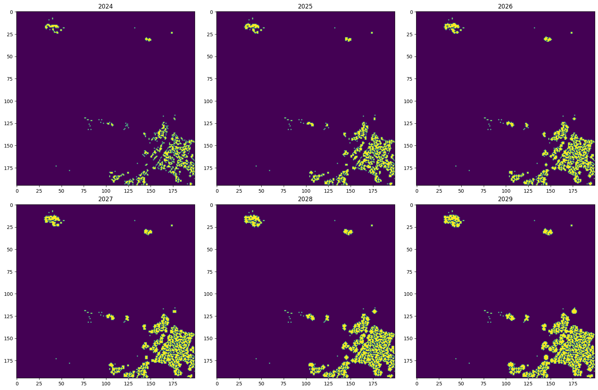
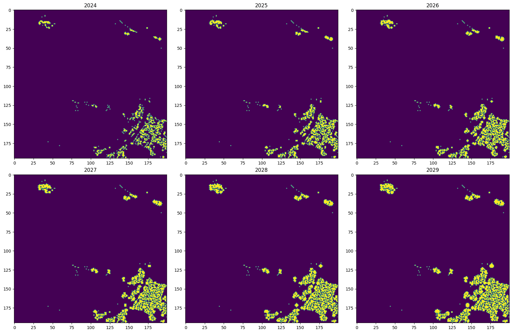
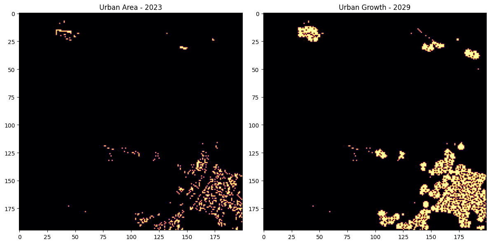
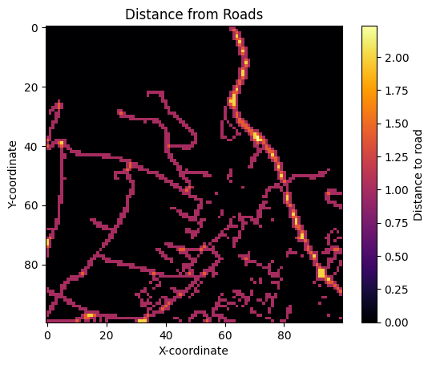
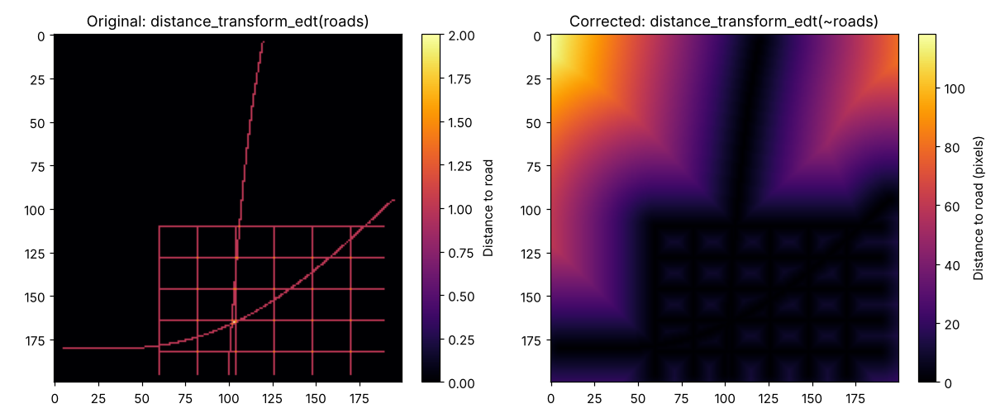
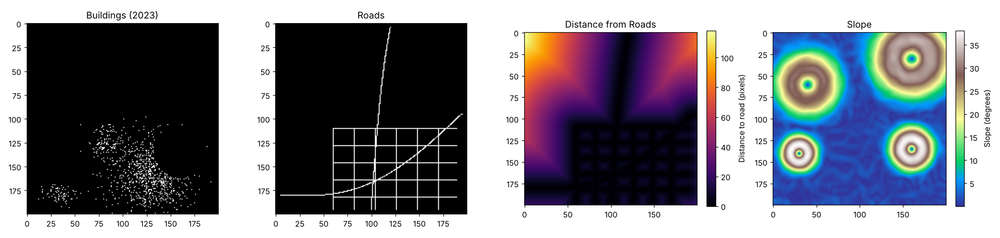
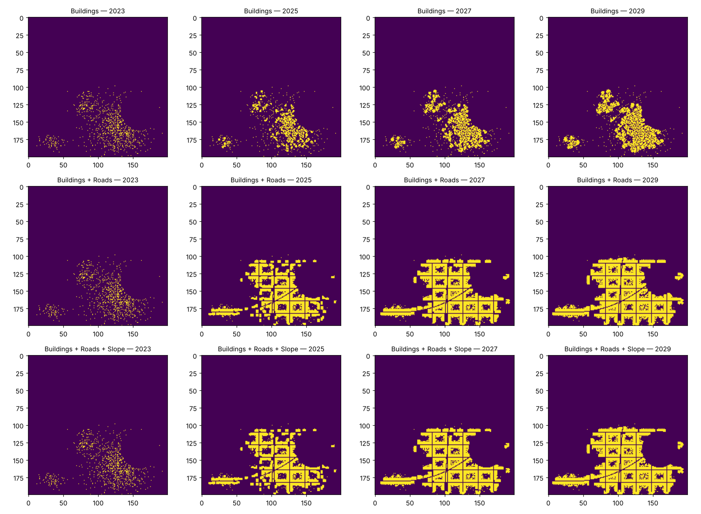
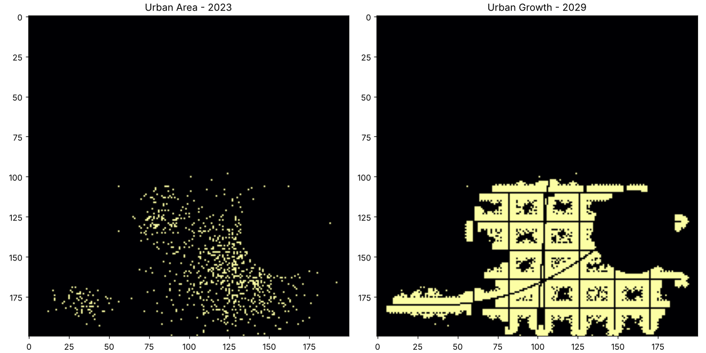
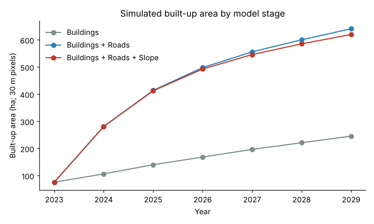

# Urban Growth Simulation with Cellular Automata

Simulating how a built-up area spreads over six years, using a cellular automaton driven by existing buildings, the road network and terrain slope. The repo contains my original model from 2024 and a corrected, re-run version from 2026, with what changed and why.

> The original model was developed in **early 2024** for the *Computational Intelligence* course of my MSc in GIS (K. N. Toosi University of Technology).
> The input rasters are confidential, so the corrected model runs on a **synthetic town** generated in code.

---

## The problem

Cities grow cell by cell. A plot of land is more likely to be developed if it is surrounded by development, close to a road, and on buildable terrain. **Cellular automata (CA)** capture exactly this kind of local, neighbour-driven process. The landscape is a grid of pixels (built or not built), and simple *transition rules* decide, year by year, which pixels become urban.

The model is built in three stages, adding one driver of growth at a time:

1. **Buildings:** growth from existing built-up neighbours only.
2. **+ Roads:** pixels close to roads develop more easily.
3. **+ Slope:** steep terrain resists development.

## Repository contents

```
original/urban_growth_ca_2024.ipynb       # the 2024 model, code as originally written (Colab)
corrected/model.py                        # corrected transition rules + synthetic-town generator
corrected/urban_growth_ca_corrected.ipynb # runs all three stages and produces the figures below
figures/                                  # figures used in this README
```

## The original model (2024)

Built-up, road and slope rasters were converted to binary grids. The model was run on two windows of the study area: a 100 × 100 px test window and a 200 × 195 px extended window. Each step was labelled as one year, from 2024 to 2029.

- **Stage 1** used neighbour-count rules inspired by Conway's Game of Life: an empty pixel becomes built when exactly 3 of its 8 neighbours are built. Built pixels are never removed, so the model is growth-only.
- **Stage 2** added a distance-to-road layer, reclassified into 10 classes, as an extra condition for new development.
- **Stage 3** added a reclassified slope layer, intended to stop growth on steep ground.

*Stage 1, extended window:*


*Stage 3, extended window:*




## What was wrong, and how it was fixed

Reviewing this code in 2026, I found that stages 2 and 3 did not do what they were designed to do.

**1. The distance-to-road layer was inside out.**
`scipy.ndimage.distance_transform_edt` returns, for every *non-zero* pixel, the distance to the nearest zero pixel. Passing it the road mask gave each road pixel's depth *inside* the road (0–2 px), and every other pixel got 0. The original distance figure shows it: values only on the road lines.



The fix is to invert the mask: `distance_transform_edt(~roads)` gives every pixel its distance *to* the nearest road.



**2. `&` is not `and`.**
In Python, the bitwise `&` binds more tightly than comparisons. So a rule like

```python
2 <= n <= 3 & distance[r, c] <= 3
```

is evaluated as `2 <= n <= (3 & distance[r, c]) <= 3`, which is a completely different condition. All combined conditions in the road and slope rules were affected. The fix is the logical `and`.

**3. Terrain could not block anything.**
Even with `and` in place, the road rule (`… or distance < 5`) made any pixel near a road urban regardless of slope, so the slope rule never took effect. In the corrected model, the slope limit applies to **every** new urban pixel.

**4. Smaller issues.**
- The terrain raster (`SlopeRec1.tif`) was a reclassified slope layer but was labelled and plotted as elevation in metres.
- The road rule alone would also have turned empty countryside along roads into city. The corrected rule requires at least one built neighbour.
- Road pixels themselves can no longer be built on.

## The corrected model (2026)

| Stage | New urban pixel when… |
|---|---|
| 1. Buildings | exactly 3 of its 8 neighbours are built |
| 2. + Roads | … **or** it is within 4 px of a road and has at least 1 built neighbour |
| 3. + Slope | … and, in every case, its slope is at most 15° |

The rules are vectorized with a neighbourhood convolution instead of nested pixel loops. The synthetic town has a scattered built-up area, a downtown road grid with two arterials, and four hills.



Each stage now behaves as designed. Stage 1 grows only from existing clusters. Stage 2 grows along the roads and fills the blocks between them. Stage 3 does the same but leaves the steep hill on the right undeveloped.





| Built-up area (ha) | 2023 | 2025 | 2027 | 2029 |
|---|---|---|---|---|
| Stage 1: Buildings | 76 | 140 | 197 | 246 |
| Stage 2: + Roads | 76 | 414 | 556 | 641 |
| Stage 3: + Roads + Slope | 76 | 413 | 546 | 620 |



## Making it more realistic

The corrected model is *logically* right but not *realistic*. In stages 2 and 3 the built-up area almost quadruples in the first year, because every eligible pixel converts immediately. With more experience, these are the changes I would make next:

- **Probabilistic transitions.** Instead of converting every eligible pixel, convert it with a probability that grows with its suitability (number of built neighbours, closeness to roads, flatness). For example, 30% per year near a road, rising with neighbour density. This smooths growth and adds realistic randomness, which also means running many simulations and reporting the range of outcomes.
- **A suitability surface instead of hard thresholds.** Combine the drivers into one continuous "development potential" (a weighted sum, or a logistic regression fitted to past growth) rather than fixed cut-offs such as "within 4 px" or "≤ 15°".
- **Calibration on real history.** Use built-up maps from at least two past dates, for example from Landsat or the Global Human Settlement Layer, to tune the rule weights so that simulating from the earlier date reproduces the later one. Only then does "one step = one year" mean anything.
- **Validation.** Compare simulated and observed maps with standard measures: overall accuracy and Kappa, Figure of Merit for the changed pixels, and landscape metrics such as patch number and compactness.
- **Established frameworks.** Models such as **SLEUTH** (Clarke et al., 1997) and constrained CA (White & Engelen, 1993) formalize these ideas. They add spontaneous, edge and road-influenced growth types and self-modifying rates, and are the natural next step from this model.
- **Exclusion layers and demand.** Mask out water, protected land and existing infrastructure, and cap annual growth with a population- or demand-driven total.

## Running the corrected model

```bash
pip install -r requirements.txt
cd corrected
jupyter notebook urban_growth_ca_corrected.ipynb
```

The original notebook was written for Google Colab and needs the confidential rasters, so it is included for reference only.

## License

[MIT](LICENSE) © 2024–2026 Kimya Kheirkhah · [github.com/KimyaKheirkhah](https://github.com/KimyaKheirkhah)
